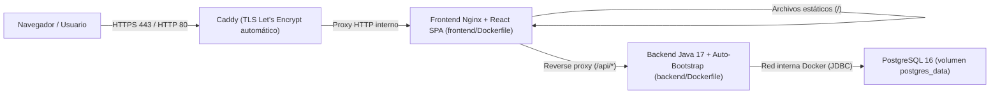

# Revisión de Seguridad, Correcciones Aplicadas y Despliegue en VPS / Vercel — Senior-Manage

Este documento consolida la auditoría de seguridad, las **correcciones aplicadas en backend y frontend**, la validación y remediación de la matriz de pruebas QA (`2.2.x` y `2.3.x`), y la integración completa generada para desplegar **Senior-Manage** en un **VPS personal con Docker Compose (Caddy HTTPS + Nginx + Backend Java 17 + PostgreSQL 16)**, manteniendo también documentada la alternativa con Vercel.

---

## 1. Resumen Ejecutivo

| Área | Estado actual | Detalle principal |
| :--- | :--- | :--- |
| **Seguridad del código** | **Remediaciones prioritarias aplicadas** | Se eliminaron archivos `.txt` con contraseñas en texto plano, se retiró el fallback de comparación sin hash, PBKDF2 subió a `210 000` iteraciones con tope de `128` caracteres, se agregó mitigación por tiempo constante (`DUMMY_HASH`), rate limiting (`429`) en login y control `PERMISOS/UPDATE`. Quedan en backlog opcional HikariCP, validación de clave actual en `change-password`, forzar clave temporal en altas admin y migración a cookies `HttpOnly`. |
| **Matriz QA (`2.2.x` y `2.3.x`)** | **Correcciones implementadas en código** | Se habilitó el registro/edición de pacientes y antecedentes para `PROFESIONAL` configurable desde permisos (`GET /api/permisos/mis-permisos`), se mostró el aviso `403` contextual dentro de la tarjeta «Antecedentes clinicos», y se añadieron validaciones de nombre (`3–120`), cédula (`6–10` dígitos), nacimiento (`60–120` años, no futura) y teléfono (`7–10` dígitos). |
| **Despliegue en VPS Personal (Docker Compose)** | **Listo para desplegar** | Se añadieron `docker-compose.yml`, `Caddyfile`, `.env.example`, `frontend/Dockerfile`, `frontend/nginx.conf`, `ContainerBootstrap.java` y arranque auto-inicializado en `Dockerfile` / `backend/Dockerfile`. *(Alternativa Vercel: `vercel.json` y `frontend/.env.example` permanecen listos).* |

---

## 2. Revisión de Seguridad y Remediaciones

### 2.1 Controles base verificados

* **Prevención de Inyección SQL (SQLi):** Las consultas SQL en [SeniorManageApiServer.java](../backend/src/presentation/SeniorManageApiServer.java) y en los repositorios `PostgresRepositorio*` utilizan `PreparedStatement` con parámetros enlazados (`?`).
* **Gestión externa de secretos:** [EnvironmentDatabaseConfiguration.java](../backend/src/infrastructure/persistence/EnvironmentDatabaseConfiguration.java#L4-L24) y [EnvironmentJwtConfiguration.java](../backend/src/infrastructure/security/EnvironmentJwtConfiguration.java#L10-L56) exigen variables de entorno externas, secreto HS256 de al menos 32 bytes y rotación de claves (`SENIOR_MANAGE_JWT_PREVIOUS_SECRET` / `SENIOR_MANAGE_JWT_PREVIOUS_KEY_ID`).
* **Tokens de vida corta y revocación en servidor:** Cada JWT expira en 15 minutos ([EnvironmentJwtConfiguration.java](../backend/src/infrastructure/security/EnvironmentJwtConfiguration.java#L20)) y su `jti` se valida y revoca en PostgreSQL mediante [PostgresRepositorioSesiones.java](../backend/src/infrastructure/PostgresRepositorioSesiones.java#L27-L33).
* **Autorización Fail-Closed y protección anti-IDOR:** [AuthorizationService.java](../backend/src/application/usecases/AuthorizationService.java#L34-L46) deniega por defecto; además, los profesionales requieren ficha `VERIFICADA` ([SeniorManageApiServer.java](../backend/src/presentation/SeniorManageApiServer.java#L1025-L1032)) y asignación activa vigente ([SeniorManageApiServer.java](../backend/src/presentation/SeniorManageApiServer.java#L1353-L1356)).
* **Límite de tamaño de payload y cabeceras HTTP:** `readForm` limita solicitudes a `16_384` bytes; `sendJson()` ([SeniorManageApiServer.java](../backend/src/presentation/SeniorManageApiServer.java#L1896-L1905)), [nginx.conf](../frontend/nginx.conf#L9-L12) y [vercel.json](../vercel.json) envían `X-Content-Type-Options: nosniff`, `X-Frame-Options: DENY` y `Referrer-Policy: strict-origin-when-cross-origin`.

---

### 2.2 Hallazgos corregidos en esta intervención

1. **Eliminación de archivos legados en texto plano y refuerzo de `.gitignore` (Severidad Alta — Resuelto)**
   * **Acción aplicada:** Se eliminaron `backend/data/usuarios.txt`, `backend/data/profesionales.txt`, el directorio `backend/data/`, `ArchivoUsuarios.java` y `ArchivoProfesionales.java`.
   * Se migraron las utilidades de consola [PruebaGestionarUsuarios.java](../backend/tests/PruebaGestionarUsuarios.java) y [PruebaGestionarUsuariosProfesionales.java](../backend/tests/PruebaGestionarUsuariosProfesionales.java) a repositorios en memoria usando `PasswordHasher`.
   * Se actualizó [.gitignore](../.gitignore#L27-L34) para excluir `/frontend/dist/`, `/backend/target/`, `/backend/data/`, `.env` y `.env.*` (manteniendo `!.env.example` y `!frontend/.env.example`).

2. **Rate limiting en `/api/auth/login` y mitigación de enumeración por tiempo (Severidad Alta — Resuelto)**
   * **Acción aplicada:** En [SeniorManageApiServer.java](../backend/src/presentation/SeniorManageApiServer.java#L67-L71) y [`login()`](../backend/src/presentation/SeniorManageApiServer.java#L335-L435) se incorporó limitación en memoria (`MAX_FAILED_LOGIN_ATTEMPTS = 8` intentos fallidos por ventana de `LOGIN_WINDOW_SECONDS = 300` segundos por IP+correo y por correo), devolviendo HTTP `429`.
   * En [`GestionarUsuarios.autenticarUsuario`](../backend/src/application/usecases/GestionarUsuarios.java#L43-L63) se añadió verificación contra `DUMMY_HASH` cuando el correo no existe o la cuenta está inactiva, reduciendo diferencias de latencia observables.

3. **Eliminación del fallback en texto plano, PBKDF2 `210 000` iteraciones y tope de longitud (Severidad Alta — Resuelto)**
   * **Acción aplicada:** En [PasswordHasher.java](../backend/src/shared/security/PasswordHasher.java#L15-L44) se elevó `ITERACIONES` de `65536` a `210000` para nuevos hashes (manteniendo lectura compatible de hashes ya persistidos) y se fijó `MAX_PASSWORD_LENGTH = 128` en `generarHash` y `verificarPassword` para evitar abuso de CPU en PBKDF2.
   * En [GestionarUsuarios.java](../backend/src/application/usecases/GestionarUsuarios.java#L54-L62) se retiró la comparación en texto plano: solo se aceptan hashes `PBKDF2-SHA256$` o `TEMPORARY$`.
   * En `changePassword()` y `handleUsers()` de [SeniorManageApiServer.java](../backend/src/presentation/SeniorManageApiServer.java#L448-L450) ([y líneas 860–902](../backend/src/presentation/SeniorManageApiServer.java#L860-L902)) se valida que las contraseñas tengan entre `8` y `128` caracteres.

4. **Autorización explícita `PERMISOS/UPDATE` en modificación de permisos (Severidad Media — Resuelto)**
   * **Acción aplicada:** En [`handlePermissionConfiguration`](../backend/src/presentation/SeniorManageApiServer.java#L980-L1023) y [`GestionarPermisos.guardarPermisoProfesional`](../backend/src/application/usecases/GestionarPermisos.java#L44-L58), las operaciones `PUT` verifican `PERMISOS/UPDATE` (aceptando temporalmente `PERMISOS/READ` para no romper instancias existentes antes de reconciliar la matriz).
   * Se añadió `ADMINISTRADOR,PERMISOS,UPDATE,true` en [permission-matrix-approved.csv](../backend/config/permission-matrix-approved.csv#L22-L23) y en [AdminPermissionsPage.tsx](../frontend/presentation/pages/AdminPermissionsPage.tsx#L22).

---

### 2.3 Mejoras recomendadas en backlog (pendientes / opcionales)

> [!NOTE]
> Los siguientes puntos no bloquearon este plan de remediación, pero siguen siendo recomendables antes de escalar carga o endurecer el ciclo de vida de cuentas:

1. **Pool de conexiones JDBC (`HikariCP`):** [JdbcConnectionProvider.java](../backend/src/infrastructure/persistence/JdbcConnectionProvider.java#L14-L30) abre una conexión TCP/TLS nueva con `DriverManager.getConnection(...)` por cada operación. Conviene añadir `HikariCP` en `pom.xml` con `maximumPoolSize` acotado (5–10).
2. **Validación de `currentPassword` en cambio voluntario de contraseña:** `POST /api/auth/change-password` ([SeniorManageApiServer.java](../backend/src/presentation/SeniorManageApiServer.java#L436-L465)) no exige verificar la contraseña actual cuando `mustChangePassword` es `false`.
3. **Forzar contraseña temporal en cuentas creadas/restablecidas por admin:** `POST /api/users` y `POST /api/users/{email}/password` aún invocan `generarHash(...)` en vez de `generarHashTemporal(...)`.
4. **Cookies `HttpOnly; Secure; SameSite=Strict`:** El frontend almacena el JWT en `sessionStorage` ([managementApi.ts](../frontend/infrastructure/managementApi.ts#L9)). A mediano plazo conviene migrar a cookie `HttpOnly` para mitigar exposición ante eventuales XSS.

---

## 3. Validación y Remediación de la Matriz de Pruebas QA (`2.2.x` y `2.3.x`)

| Caso QA | Diagnóstico original | Corrección implementada |
| :--- | :--- | :--- |
| **2.2.2** Restringir permisos de profesionales hacia pacientes | En `GestionarPermisos` y `AdminPermissionsPage.tsx` faltaban `PACIENTES/CREATE` y `PACIENTES/UPDATE` como configurables; además el botón «Editar» de `ElderlyPage.tsx` era visible para el profesional aunque no abría el formulario. | Se agregaron `PACIENTES/CREATE` y `PACIENTES/UPDATE` a `CONFIGURABLE_PROFESSIONAL_PERMISSIONS` ([GestionarPermisos.java](../backend/src/application/usecases/GestionarPermisos.java#L12-L17)), a [permission-matrix-approved.csv](../backend/config/permission-matrix-approved.csv#L29-L35) y a [AdminPermissionsPage.tsx](../frontend/presentation/pages/AdminPermissionsPage.tsx#L25-L29). Se creó `GET /api/permisos/mis-permisos` ([SeniorManageApiServer.java](../backend/src/presentation/SeniorManageApiServer.java#L986-L989)) consumido por [`listMyPermissions`](../frontend/infrastructure/managementApi.ts#L222) en [ElderlyPage.tsx](../frontend/presentation/pages/ElderlyPage.tsx#L98-L113) para mostrar u ocultar botones y formularios según permiso real. |
| **2.2.3** Restringir permisos de profesionales sobre antecedentes | Cuando `ANTECEDENTES/READ` estaba desactivado, el `403` se guardaba en `error` global y ocultaba la tarjeta «Antecedentes clinicos»; además faltaban `ANTECEDENTES/CREATE` y `UPDATE` configurables y edición en UI. | En [ElderlyPage.tsx](../frontend/presentation/pages/ElderlyPage.tsx#L85-L86) se separaron `historyError` y `historyNotice` para renderizar el aviso dentro de la tarjeta «Antecedentes clinicos»; se habilitaron creación y edición de antecedentes (`canReadHistory`, `canCreateHistory`, `canUpdateHistory`) y en [`handlePatientRoutes`](../backend/src/presentation/SeniorManageApiServer.java#L1321-L1328) se normalizó la precondición de paciente a `"READ"` en rutas de antecedentes. |
| **2.3.1** Registro de paciente y persistencia (Profesional - Happy Path) | Bloqueado por `403` fijo en `POST /api/pacientes` para `Rol.PROFESIONAL` y formulario restringido a `isAdmin` en `ElderlyPage.tsx`. | Se retiró el bloqueo fijo en [SeniorManageApiServer.java](../backend/src/presentation/SeniorManageApiServer.java#L1366-L1380): si el profesional tiene cuenta habilitada (`profesionalHabilitado`) y permiso `PACIENTES/CREATE`, puede registrar pacientes y queda auto-asignado inmediatamente con `assignmentManagement.reasignar(created.getId(), session.email)`. En [ElderlyPage.tsx](../frontend/presentation/pages/ElderlyPage.tsx#L108-L109) el formulario depende de `canCreatePatient` / `canUpdatePatient`. |
| **2.3.2** Validación del formato cédula | Solo se validaba `isBlank()`, permitiendo letras o longitudes arbitrarias. | [`Paciente.validarDatosRegistro`](../backend/src/domain/entities/Paciente.java#L41-L44) y [`validatePatientForm`](../frontend/presentation/pages/ElderlyPage.tsx#L39-L41) exigen cédula numérica de 6 a 10 dígitos (`^\d{6,10}$`). |
| **2.3.3** Campos obligatorios | `birthDate` y `phone` eran opcionales (`null`) tanto en dominio como en UI. | Nombre completo (`3–120` caracteres), documento, fecha de nacimiento y teléfono son ahora obligatorios tanto en [Paciente.java](../backend/src/domain/entities/Paciente.java#L37-L64), [`GestionarPacientes.actualizar`](../backend/src/application/usecases/GestionarPacientes.java#L28-L30) y [ElderlyPage.tsx](../frontend/presentation/pages/ElderlyPage.tsx#L32-L70) (con `noValidate` para mostrar mensajes claros). |
| **2.3.4** / **2.3.5** Fecha de nacimiento (happy path y negativa) | Aceptaba cualquier fecha `AAAA-MM-DD`, incluidas fechas futuras o edades menores de 60 / mayores de 120 años. | Se exige formato `AAAA-MM-DD` calendario válido, no futuro (`!fechaNacimiento.isAfter(hoy)`), edad mínima de `60` años y máxima de `120` años en [Paciente.java](../backend/src/domain/entities/Paciente.java#L45-L57) y [ElderlyPage.tsx](../frontend/presentation/pages/ElderlyPage.tsx#L42-L65). |
| **2.3.6** / **2.3.7** Número de teléfono (happy path y negativa) | No validaba dígitos ni longitud en backend ni frontend. | Se exige teléfono numérico entre `7` y `10` dígitos (`^\d{7,10}$`) en [Paciente.java](../backend/src/domain/entities/Paciente.java#L58-L64) y [ElderlyPage.tsx](../frontend/presentation/pages/ElderlyPage.tsx#L66-L68). |

---

## 4. Despliegue Completo en VPS Personal con Docker Compose + HTTPS

### 4.1 Arquitectura en el VPS

Toda la pila corre aislada dentro de un único stack Docker Compose bajo un mismo dominio y HTTPS automático:



---

### 4.2 Archivos Generados e Integrados para el VPS

1. **[docker-compose.yml](../docker-compose.yml):** Orquesta los 4 servicios:
   * `db` (`postgres:16-alpine`): volumen persistente `postgres_data`, sin exponer el puerto `5432` a internet y con `healthcheck` mediante `pg_isready`.
   * `backend`: construido desde [backend/Dockerfile](../backend/Dockerfile); espera a `db` saludable y ejecuta healthcheck sobre `/api/health`.
   * `frontend`: construido desde [frontend/Dockerfile](../frontend/Dockerfile) con `VITE_API_URL=/api`; espera a `backend` saludable.
   * `caddy` (`caddy:2-alpine`): expone `80` y `443` usando [Caddyfile](../Caddyfile) con certificados HTTPS automáticos cuando `SITE_ADDRESS` es un dominio público (o `:80` por HTTP si se prueba temporalmente con IP).
2. **[ContainerBootstrap.java](../backend/src/infrastructure/bootstrap/ContainerBootstrap.java):** Inicializador no interactivo ejecutado al arrancar el contenedor cuando `SENIOR_MANAGE_AUTO_BOOTSTRAP=true` (configurado en [Dockerfile](../Dockerfile#L25-L32) y [backend/Dockerfile](../backend/Dockerfile#L25-L32)):
   * Espera la disponibilidad de PostgreSQL (hasta 30 intentos con 2 s de pausa).
   * Ejecuta las migraciones Flyway `V1`–`V6`.
   * Crea la cuenta administradora inicial de forma idempotente si se definen `SENIOR_MANAGE_INITIAL_ADMIN_EMAIL` y `SENIOR_MANAGE_INITIAL_ADMIN_PASSWORD` (12–128 caracteres).
   * Verifica el SHA-256 de [permission-matrix-approved.csv](../backend/config/permission-matrix-approved.csv) (`6EDB8C419013B86D62BABAC0A9D1F9668918158AA332AA7BF5B46B9EE60FA969`) y aplica o reconcilia la matriz aprobada en `permisos_rol` si aún no coincide.
3. **[frontend/Dockerfile](../frontend/Dockerfile) y [frontend/nginx.conf](../frontend/nginx.conf):** Compila React/Vite en `node:20-alpine` con `npm ci`, sirve `dist/` en `nginx:1.27-alpine` con fallback SPA (`try_files $uri $uri/ /index.html;`), cabeceras de seguridad HTTP y proxy `/api/` hacia `http://backend:8080/api/`.
4. **[.env.example](../.env.example):** Plantilla completa para configurar dominio, PostgreSQL, secretos JWT y administrador inicial en el VPS.
5. **Alternativa Vercel conservada:** [vercel.json](../vercel.json), [frontend/.env.example](../frontend/.env.example), [.dockerignore](../.dockerignore) y el soporte `PORT` / `0.0.0.0` / CORS múltiple en [SeniorManageApiServer.java](../backend/src/presentation/SeniorManageApiServer.java#L149-L188) siguen funcionando si en el futuro deseas servir el frontend desde Vercel (`https://senior-manager-ten.vercel.app`).

---

### 4.3 Pasos para Desplegar en tu VPS Personal

1. **Requisitos en el VPS (Ubuntu/Debian):** tener instalados Docker Engine y Docker Compose v2, y abrir los puertos `80` y `443` en el firewall (y en el panel de seguridad del proveedor).
2. **Clonar el repositorio y crear `.env`:**
   ```bash
   git clone <URL_DE_TU_REPO> Senior_Manager
   cd Senior_Manager
   cp .env.example .env
   ```
3. **Generar secretos fuertes y editar `.env`:**
   ```bash
   openssl rand -hex 24      # Para POSTGRES_PASSWORD
   openssl rand -base64 48   # Para SENIOR_MANAGE_JWT_SECRET (minimo 32 bytes)
   nano .env
   ```
   En `.env`, configura especialmente:
   * Con dominio apuntando al VPS:
     ```env
     SITE_ADDRESS=app.tudominio.com
     SENIOR_MANAGE_FRONTEND_ORIGIN=https://app.tudominio.com
     ```
     *(Si solo pruebas por IP temporalmente: deja `SITE_ADDRESS=:80` y usa `SENIOR_MANAGE_FRONTEND_ORIGIN=http://TU_IP_DEL_VPS`).*
   * `POSTGRES_PASSWORD`, `SENIOR_MANAGE_JWT_SECRET`, `SENIOR_MANAGE_INITIAL_ADMIN_NAME`, `SENIOR_MANAGE_INITIAL_ADMIN_EMAIL` y `SENIOR_MANAGE_INITIAL_ADMIN_PASSWORD` (mínimo 12 caracteres).
4. **Compilar y levantar todo el stack:**
   ```bash
   docker compose up -d --build
   ```
5. **Verificar estado y logs:**
   ```bash
   docker compose ps
   docker compose logs -f backend
   ```
   Cuando `backend` reporte saludable (`ContainerBootstrap: inicialización completada correctamente.` y `Senior-Manage API disponible...`), podrás entrar directamente a `https://app.tudominio.com` (o `http://TU_IP_DEL_VPS`) e iniciar sesión con la cuenta administradora inicial.
6. *(Opcional)* Una vez creada la cuenta administradora en producción, puedes vaciar o retirar `SENIOR_MANAGE_INITIAL_ADMIN_PASSWORD` de `.env` y recrear el contenedor si lo prefieres (el bootstrap verificará que ya existe un administrador activo en `usuarios`).

> [!IMPORTANT]
> Si ya tuvieras una base PostgreSQL externa previa en vez de usar el contenedor `db` nuevo, recuerda aplicar o reconciliar `permisos_rol` ejecutando `PermissionBootstrap --apply-approved backend/config/permission-matrix-approved.csv` con `SENIOR_MANAGE_PERMISSION_MATRIX_SHA256=6EDB8C419013B86D62BABAC0A9D1F9668918158AA332AA7BF5B46B9EE60FA969` (ver [backend/README.md](../backend/README.md#L42)).

---

## 5. Verificaciones Ejecutadas tras los Cambios

* **SHA-256 de matriz de permisos (`shasum -a 256`):** `6edb8c419013b86d62babac0a9d1f9668918158aa332aa7bf5b46b9ee60fa969` coincidente con [backend/README.md](../backend/README.md#L42), [repair-approved-permissions.ps1](../backend/scripts/repair-approved-permissions.ps1#L5) y [ContainerBootstrap.java](../backend/src/infrastructure/bootstrap/ContainerBootstrap.java#L27).
* **Frontend TypeScript (`npm --prefix frontend run typecheck`):** Ejecutado con éxito (`tsc --noEmit`, código de salida `0`).
* **Frontend Vite Build:** En el entorno local macOS, `frontend/node_modules` proviene de Windows y carece de `@rollup/rollup-darwin-arm64`; en Docker (`frontend/Dockerfile`), `npm ci` instala las dependencias nativas limpias para Linux Alpine antes de compilar.
* **Backend Java 17 (`mvn -f backend/pom.xml -o test-compile`):** Compiló los `46` archivos fuente principales (incluido `ContainerBootstrap.java`) y `3` archivos fuente de prueba con `javac` Java 17 (`BUILD SUCCESS`).
* **Prueba automatizada `PruebaLogin` (`mvn -f backend/pom.xml -o -Dexec.classpathScope=test -Dsenior.manage.mainClass=PruebaLogin exec:java`):** Ejecutada con resultado `PruebaLogin: 14 casos/verificaciones correctos.` (`BUILD SUCCESS`). *(Nota: no se ejecutó `docker compose up` ni se conectó a una instancia PostgreSQL viva en este entorno de desarrollo).*
